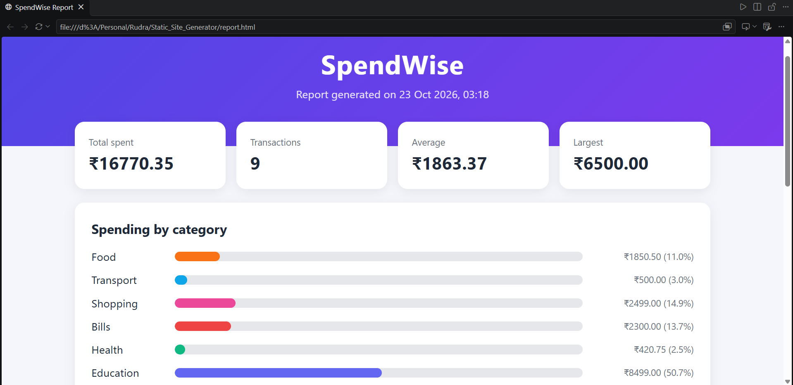

# SpendWise 💸

A lightweight expense tracker written in **C** that generates a clean,
responsive **HTML/CSS** dashboard.

## Features
- Add, list and delete expenses from a terminal menu
- Persistent storage in a simple CSV file
- One-command HTML dashboard with summary cards, a CSS-only bar chart
  and an expense table
- Input validation and HTML escaping
- Zero dependencies: just a C compiler and a browser

## Run it
    gcc main.c -o spendwise
    ./spendwise

Choose option 4 to generate `report.html`, then open it in your browser.

## Tech
C (structs, file I/O, string handling) · HTML · CSS (Grid, animations)

## Future ideas
- Monthly filtering and budgets
- Export to PDF
- Web version using WebAssembly
- Javascript enhancement(in work)